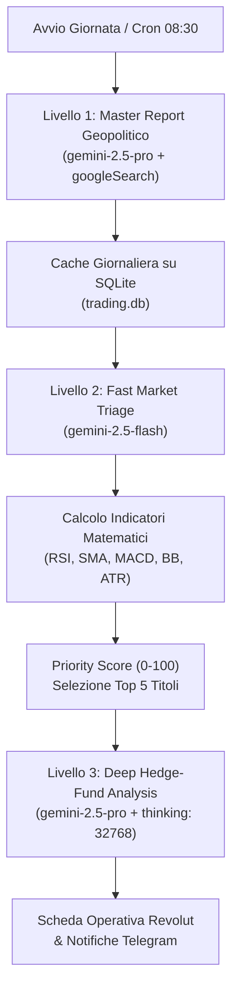

# 🚀 AiTrading - Private AI Trading Analyst & Risk Manager for Revolut

**AiTrading** è una web app self-hosted containerizzata in **Docker**, concepita per girare su un mini PC Ubuntu Server / CasaOS e accessibile da smartphone via **Tailscale**.
Funziona come il tuo **Analista Quantitativo e Risk Manager privato basato su AI**: non esegue trading automatico, ma calcola matematicamente indicatori di borsa, notizie geopolitiche in tempo reale, commissioni e gestione del capitale per dirti esattamente **cosa comprare o vendere manualmente sul tuo conto Revolut**, a che prezzo limite e con quanti Euro, inviandoti notifiche e schede operative istantanee su **Telegram**.

---

## 🏛 Architettura & Stack Tecnologico

* **Frontend & Backend:** Next.js (App Router in modalità `standalone` per Docker), React 19, TypeScript, Tailwind CSS con estetica dark professionale stile **Bloomberg Terminal** ottimizzata per mobile **PWA**.
* **Database Persistente:** **SQLite con Prisma ORM** salvato in `/app/data/trading.db` e montato come volume Docker (`./data:/app/data`).
* **Automazione Background:** Motore interno `node-cron` programmato di default alle **08:30** (apertura europea), alle **15:00** (pre-market Wall Street) e con monitoraggio orario di sicurezza a mercati aperti per Stop Loss e crolli improvvisi.
* **Dati di Mercato & News Live:** `yahoo-finance2` per quotazioni, cambio `EURUSD=X` live, fondamentali e storico candele + `technicalindicators` per calcoli matematici + feed RSS (Reuters, CNBC, Google News Finanza).
* **Grafici Interattivi:** TradingView `lightweight-charts` con linee orizzontali automatiche per *Entry, Break-Even, Take Profit e Stop Loss*.

---

## 🧠 Pipeline AI Multi-Stadio (`@google/genai`)

L'app implementa una pipeline a 3 livelli per massimizzare la resa dei token del tuo piano Gemini:



1. **Livello 1: Global Geopolitical Daily Brief (`gemini-2.5-pro` + `googleSearch: {}`)**
   Una sola chiamata giornaliera che analizza guerre, tensioni USA/Cina/Taiwan, Medio Oriente, decisioni FED/BCE, dazi e supply chain dei chip. Memorizzato su SQLite e iniettato come contesto base per tutte le analisi dei singoli titoli.
2. **Livello 2: Fast Market Triage (`gemini-2.5-flash`)**
   Screening veloce della Watchlist (30-50 titoli): calcola prima gli indicatori tecnici localmente e poi usa Gemini Flash per analizzare i titoli delle news e assegnare un `priorityScore` (0-100).
3. **Livello 3: Deep Hedge-Fund Analysis (`gemini-2.5-pro` alla Massima Potenza)**
   Attivato sui titoli in portafoglio, sui Top 5 del triage e su qualsiasi titolo cliccato manualmente:
   * `thinkingConfig: { thinkingBudget: 32768 }` (ragionamento profondo multi-passo).
   * `googleSearch: {}` per breaking news dell'ultima ora sul ticker.
   * `responseSchema` rigorosamente tipizzato in JSON.

---

## 💰 Modulo Revolut Plan Optimizer & Position Sizing

Il motore matematico (`lib/revolut-engine.ts`) calcola in tempo reale:
* **Tasso di Cambio EUR/USD & Weekend Markup:** Rileva automaticamente se è weekend (dalle 22:00 UTC del venerdì alle 22:00 UTC della domenica) e applica l'**1% di maggiorazione Revolut**, avvisandoti di non convertire valuta prima della riapertura dei mercati.
* **Prezzo di Pareggio Reale (Break-Even):** Calcola il vero prezzo di pareggio includendo la commissione di acquisto e vendita (0% se hai slot gratuiti residui, altrimenti 0.25% min 1€) e le micro-tasse regolamentari USA (**SEC fee** $0.0000278 e **FINRA TAF** $0.000166 per azione).
* **Position Sizing Oggettivo:**
  $$\text{Rischio Massimo USD} = (\text{Liquidità EUR} \times \text{Rischio \%}) \times \text{EURUSD}$$
  $$\text{Azioni Frazionarie} = \frac{\text{Rischio Massimo USD}}{|\text{Prezzo Ingresso} - \text{Stop Loss ATR}|}$$
  Il sistema ti dice esattamente quanti Euro investire e quante azioni frazionate comprare affinché la perdita non superi mai la tua soglia di rischio impostata.

---

## 📲 Notifiche Telegram ("Revolut Action Alerts")

Configurabile tramite `.env` o direttamente dall'interfaccia UI (con tasto *"Invia Messaggio di Test"*):
1. **Briefing Programmato (08:30 e 15:00):** Sintesi macroeconomica, sentiment geopolitico, allarmi portafoglio e Top 2-3 occasioni di acquisto con Conviction Score $\ge 75$.
2. **Allarme Urgente Portafoglio:** Se un titolo posseduto su Revolut tocca lo Stop Loss, riceve un verdetto *"VENDI TUTTO"* o crolla di oltre il 5% intra-day.
3. **Scheda "Copia su Revolut":** Formattata con blocchi `code` monospazio: su iPhone basta toccare il prezzo o la quantità per copiarli direttamente negli appunti e incollarli nell'app Revolut!

---

## 🐳 Installazione su CasaOS / Ubuntu Server con Docker

### 1. Clona il repository o copia la cartella sul server
```bash
git clone https://github.com/tuo-username/aitrading.git
cd aitrading
```

### 2. Configura le variabili d'ambiente
Copia il file `.env.example` in `.env`:
```bash
cp .env.example .env
nano .env
```
Inserisci:
* `GEMINI_API_KEY`: La tua chiave API da [Google AI Studio](https://aistudio.google.com/).
* `TELEGRAM_BOT_TOKEN`: Il token del tuo bot Telegram (creato con [@BotFather](https://t.me/BotFather)).
* `TELEGRAM_CHAT_ID`: Il tuo chat ID numerico (ottenuto avviando [@userinfobot](https://t.me/userinfobot)).

### 3. Avvia il container con Docker Compose
```bash
docker compose up -d --build
```
L'applicazione sarà attiva e funzionante su `http://IP-DEL-TUO-SERVER:3050`.

### Installazione con Interfaccia CasaOS
1. Apri la dashboard di CasaOS.
2. Clicca su **App Store** -> **Custom Install** (in alto a destra).
3. Importa il file `docker-compose.yml` oppure compila i campi:
   * **App Name:** `AiTrading Revolut`
   * **Port:** `3050` -> `3000`
   * **Volumes:** `/DATA/AppData/aitrading/data` -> `/app/data`
   * **Environment Variables:** `GEMINI_API_KEY`, `TELEGRAM_BOT_TOKEN`, `TELEGRAM_CHAT_ID`, `TZ=Europe/Rome`.
4. Clicca su **Installa**.

---

## 📱 Accesso da iPhone via Tailscale & Installazione PWA

1. Installa l'app **Tailscale** sia sul tuo server CasaOS/Ubuntu sia sul tuo iPhone e collegali allo stesso account.
2. Sull'iPhone apri **Safari** e naviga all'indirizzo Tailscale del tuo server:
   ```text
   http://100.x.y.z:3050
   ```
3. Tocca il pulsante **Condividi** di Safari (l'icona del quadrato con la freccia verso l'alto).
4. Seleziona **"Aggiungi alla schermata Home"**.
5. L'app si aprirà a schermo intero senza barre del browser come una vera applicazione nativa iOS, consentendoti di consultarla affiancata all'app Revolut.

---

## ⚙️ Configurazione Iniziale e Utilizzo

1. **Impostazioni Conto:** Vai nella scheda `⚙️ Impostazioni` e verifica la tua liquidità disponibile (EUR), il rischio percentuale (es. 1.5%), il piano Revolut attivo e il numero di trade gratuiti rimasti.
2. **Test Telegram:** Clicca sul pulsante `Invia Messaggio di Test` per verificare la ricezione immediata sul tuo smartphone.
3. **Genera il Report Geopolitico:** Vai nella scheda `🌍 Macro & Geopolitica` e tocca `Rigenera Report Oggi`.
4. **Scansione Watchlist:** Nella scheda `🔥 Radar` tocca `Fast Triage (Flash)` per calcolare i priority score, oppure clicca su qualsiasi titolo per avviare l'analisi approfondita con Gemini 2.5 Pro.
5. **Esecuzione Trade:** Quando visualizzi una scheda verde *"COMPRA ORA"*, usa i tasti di copia rapida per inserire Prezzo e Azioni sull'app Revolut, poi premi `-1 Trade Usato` sulla barra superiore per aggiornare il contatore mensile.
